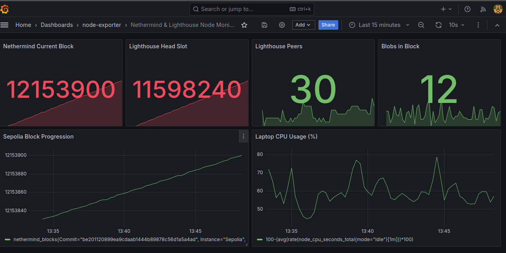

# Sepolia Ethereum Node & Real-Time Event Indexer (Nethermind + Lighthouse)

A self-hosted Ethereum Sepolia node deployed with **Sedge**, monitored via **Prometheus & Grafana**, and paired with a zero-dependency **Python JSON-RPC event streamer** that tracks blocks and benchmarks `eth_getLogs` latency locally.

## Architecture
- **Execution Client:** Nethermind (`v2.2.2`) exposing JSON-RPC (`8545`), Engine API (`8551`), and Prometheus metrics (`8008`).
- **Consensus Client:** Lighthouse (`v8.3.3`) synced via Checkpointz (`beaconstate-sepolia.chainsafe.io`) exposing Beacon API (`4000`) and metrics (`5054`).
- **Observability Stack:** Prometheus scraping execution, consensus, and host Node Exporter metrics into custom Grafana dashboards (`3000`).
- **Event Indexer (`stream_sepolia.py`):** Queries `eth_blockNumber`, `eth_getBlockByNumber`, and `eth_getLogs` to decode live ERC-20 `Transfer` events and measure local RPC response latency.

## Live Grafana Telemetry


## Key Engineering Troubleshooting Solved
1. **Engine API & Fork Schema Alignment:** Diagnosed `InvalidSsz` checkpoint decoding errors and `Not receiving ForkChoices` warnings caused by pre-fork client binaries and a deprecated checkpoint sync URL. Upgraded both clients and re-initialized consensus state from a healthy Checkpointz upstream.
2. **Prometheus & Grafana Provisioning:** Configured custom scrape targets for Nethermind (`8008`) and Lighthouse (`5054`) and mapped Prometheus datasource UIDs to visualize real-time block height, head slot progression, peer count, and EIP-4844 blob counts.

## Usage
Ensure your local Nethermind node is running and synced on `http://localhost:8545`, then run:

```bash
python3 stream_sepolia.py
```
